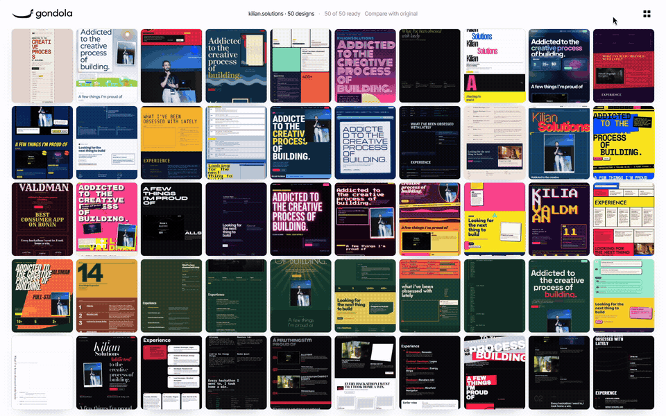

<p align="center">
  
</p>

<p align="center">
  <b>Enter a domain. Watch 50 AI designers redesign it at the same time, live.</b><br>
  Every designer works in its own <a href="https://boat.dev">Boat</a> sandbox.
</p>

<p align="center">
  
</p>

<p align="center">
  <a href="docs/media/timelapse.mp4">▶ Watch a whole run, from typing the domain to 50 finished sites (40 s)</a>
</p>

## How it works

1. **Read.** One sandbox opens your site and copies every word, image and colour.
2. **Fork.** [Boat](https://boat.dev) forks that sandbox 50 times in about a minute.
3. **Direct.** A curator gives each fork its own art direction: Swiss poster, split-flap board, Hokusai print,
   rave flyer… with a wild palette and a hero idea built from your real content.
4. **Build.** 50 agents design at once. You watch every page appear live in a grid that fits one screen.
5. **Keep.** Finished pages are saved to your own server and the sandboxes are deleted. Copy any design as a
   Claude Code prompt that restyles your whole site in that direction.

## Run it

```sh
git clone https://github.com/forever8896/gondola && cd gondola
bun run setup     # checks Bun, Docker and the Boat CLI, writes .env, starts Postgres
bun run start     # open http://localhost:8787
```

You need [Bun](https://bun.sh), [Docker](https://docs.docker.com/get-docker/), a [Boat](https://boat.dev) account
(`boat login`) and an [OpenRouter](https://openrouter.ai) key with about $10 of credit.

A 25-design run costs about **$2** in model tokens plus a few cents of Boat compute, and takes 5–7 minutes. Set
`DEFAULT_COUNT=50` in `.env` for the full wall.

Recording a demo? `bun run prewarm yourdomain.com` reads the site ahead of time, so the next run starts forking
the moment you press enter.

## Built with

- **[Boat](https://boat.dev)**: sandboxes that fork in seconds, live preview URLs and per-second billing
- **Claude Haiku 5.5** (designs, art direction), **DeepSeek V4.1 Flash** (reading the site) and **Gemini
  Flash-Lite** (describing images), through [OpenRouter](https://openrouter.ai)
- **Bun** and **Postgres**, with a vanilla JS frontend and no build step

## Docs

- [Guide](docs/GUIDE.md): requirements, costs and limits, how a run works, configuration, troubleshooting
- [Access control](docs/ACCESS-CONTROL.md): read this before hosting Gondola for other people

## License

[MIT](LICENSE). If Gondola helps you make something, a link back is appreciated.
